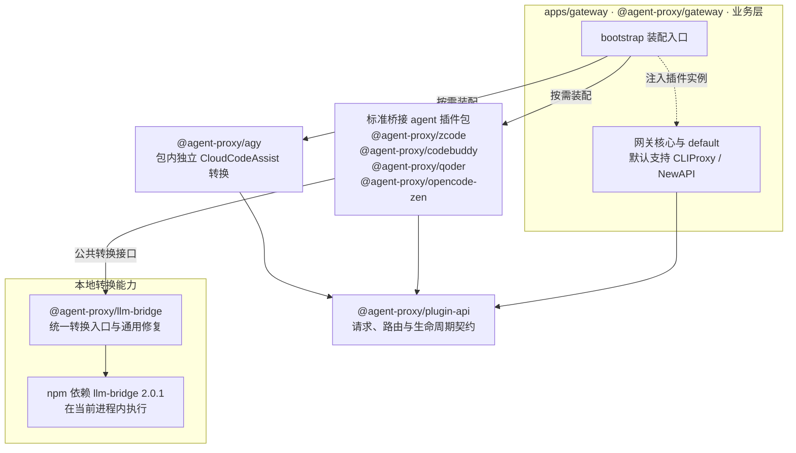
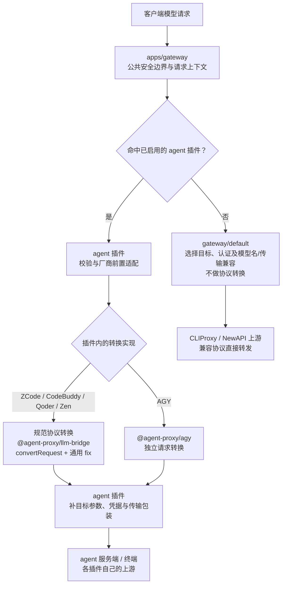

# Agent Proxy monorepo 与 agent 插件化需求

状态：monorepo 与插件迁移已完成；转换封装仍由独立计划负责，未执行发布。
日期：2026-10-10。
工作分支：`codex/gateway-monorepo`。
实施基线：`main` 的 `a20587d9da3e375219dca7199c892ddb639d4d64`（v0.10.0）。

## 1. 目标与已确认要求

2026-10-11 实施澄清：本轮结构迁移保留 main 的现有协议转换实现，以 Responses endpoint 到各 agent 的行为一致、打包后可由 Codex 正常调用为验收目标；不新增或重写转换算法。下文统一 `convertRequest` 与转换兼容要求由独立转换计划后续交付，不作为迁包前置条件。现有 CodeBuddy/Qoder 转换复用和外部 llm-bridge 调用可通过显式包依赖保持原行为。

按“bridge 封装 → 网关插件方法 → agent 接入与差异适配”的目标分层，将现有单包改成 Bun workspace monorepo。所有 agent 兼容能力通过插件注入网关；规范协议转换由基于外部 llm-bridge 的封装完成，AGY 的 CloudCodeAssist 转换在自身包内独立实现。实施先完成 monorepo 迁移及验收，再按独立转换计划推进。

实施分为两个计划：[monorepo、插件化与安装配置迁移](../exec-plans/completed/codex-gateway-monorepo.md)负责包结构、注册/装配、生命周期与安装配置；[llm-bridge 封装与兼容](../exec-plans/active/llm-bridge-conversion-compatibility.md)负责转换层、agent 转换调用适配和 Chat Completions 兼容/测试。Chat Completions 要求直接纳入转换封装，不另保留独立 Chat Completions 端点计划。

原独立协议抽离计划同样弃用并撤下：通用请求/响应、解析、工具身份、usage、流式事件/输出外壳及回归要求统一在 llm-bridge 封装中重构；原插件与网关生命周期要求由 monorepo 计划承接，不再维护第三份独立计划。

- `@agent-proxy/llm-bridge` 是转换层，底座采用外部 `llm-bridge`，修复 Chat Completions 工具声明、调用历史等转换损失。
- ZCode、CodeBuddy/WorkBuddy、Qoder、Zen 的标准请求统一调用封装的 `convertRequest`，插件处理自身兼容差异，不得直接依赖外部 llm-bridge。
- AGY 的请求/响应/SSE/JSON 转换在 `@agent-proxy/agy` 内独立封装，不依赖或调用桥接转换包，也不直接依赖 npm llm-bridge；公共桥接只处理规范协议，不包含 AGY 或 CloudCodeAssist 类型/hooks。
- `@agent-proxy/gateway` 提供网关与插件注入能力，默认支持 CLIProxy/NewAPI；保留 main 当前的官方路由、认证和 upstreamOnly 语义。
- CLI 命令由 `codex-cliproxy` 改为 `agent-proxy`；业务包 bin、帮助、UI 命令提示、受管启动入口及当前使用文档同步更名，子命令与参数语义保留，纳入 monorepo 计划 S4/S5。
- 不采用旧 feature/protocol-conversion-m1 分支的“重新手写一套完整转换器、各 agent 直接组合纯原语”路线。
- 从 main 开始独立迁移，不合入该旧重构分支，不复制其 src/protocols 作为转换核心。旧分支及其未提交内容保留。

## 2. 包职责与依赖方向

用户确认统一使用 `@agent-proxy/*` 命名空间，网关业务包为 `@agent-proxy/gateway`，目录为 `apps/gateway`。包名与职责如下：

| 包 | 目录 | 职责 |
| --- | --- | --- |
| `@agent-proxy/llm-bridge` | `packages/llm-bridge` | 外部库封装、公共协议类型、请求/流式/解析接口及通用修复 |
| `@agent-proxy/plugin-api` | `packages/plugin-api` | 插件/主机契约、模型与传输生命周期类型，避免网关与 agent 循环依赖 |
| `@agent-proxy/zcode` | `packages/zcode` | ZCode 插件、服务端工具与搜索、thinking、vision 与自有传输 |
| `@agent-proxy/codebuddy` | `packages/codebuddy` | CodeBuddy/WorkBuddy 插件、身份/地域、reasoning 信封与自有传输 |
| `@agent-proxy/qoder` | `packages/qoder` | Qoder 插件、目录档位、COSY、排队、计费及请求信封 |
| `@agent-proxy/agy` | `packages/agy` | Antigravity 插件、独立请求/响应转换、签名/schema 兼容与 CloudCodeAssist 包装 |
| `@agent-proxy/opencode-zen` | `packages/opencode-zen` | Zen 插件、指纹、模型协议探测、入口政策与聚合 |
| `@agent-proxy/gateway` | `apps/gateway` | 业务应用：网关启动与装配、default、HTTP/WS、CLI/Web UI、配置与模型管理 |

`@agent-proxy/gateway` 是业务层，不属于 packages 中的可复用库。目录分层如下：

```text
apps/
└── gateway/              # 网关业务应用与插件装配
packages/
├── llm-bridge/           # 通用转换封装
├── plugin-api/           # 已确认的最小插件契约
├── zcode/
├── codebuddy/
├── qoder/
├── agy/
└── opencode-zen/
```

已确认增设 `@agent-proxy/plugin-api`（`packages/plugin-api`）作为独立的最小契约包，纳入本轮实施范围。它只承载插件/主机契约、模型与传输生命周期类型，不读取文件、启动服务器或实现厂商逻辑。

```text
llm-bridge ───────────→ 外部 llm-bridge
标准桥接 agent 包 ───→ llm-bridge + plugin-api
agy 包 ─────────────→ plugin-api（转换在包内独立实现）
网关核心 ───────────→ plugin-api
gateway 的 bootstrap ──→ 被显式装配的 agent 包
```

- 转换包不依赖 gateway、plugin-api 或任何 agent，不含 OpencodeZenClientProtocol 等使用方类型。
- agent 不导入网关实现；agent 之间不依赖对方的通用请求转换器，Qoder 解除对 CodeBuddy 转换函数的耦合。
- 网关应用只在组合入口导入 agent 工厂；路由、目录、日志与关闭核心不 import 具体 agent，不写五组厂商分支。
- gateway/default 不依赖或调用桥接转换包。CLIProxy/NewAPI 已兼容客户端协议，由 default 按原协议转发；装配 agent 带来的转换包传递依赖不意味着 default 经过转换。
- 根包改为 private workspace，覆盖 apps/* 与 packages/*，保留现有 Bun/TypeScript/Lerna 工具链。packages 的库构建/exports/发布与 apps/gateway 的应用构建/交付分别配置；不把 gateway 当作公共复用库发布。

### 包依赖图

实线表示本地包依赖，虚线表示装配入口把插件实例注入网关。此图不表示网络请求，npm llm-bridge 是本地库，不是外部服务或 agent 终端；网关核心没有指向转换包的依赖。plugin-api 为已确认的独立最小契约包。



依赖方向为业务层调用 packages；标准桥接 agent 调用 llm-bridge，AGY 只在自身包转换。转换包与插件包不反向依赖 apps/gateway。图示为最终依赖要求，AGY 的无用 bridge 依赖清理在 monorepo 验收后随转换计划实施。

## 3. 转换层契约

### 3.1 基于外部库的统一入口

- 公开协议标识使用 `chat-completions`、`responses`、`anthropic`、`gemini`；名称写为 Chat Completions。HTTP `/chat/completions`、线上对象类型 `chat.completion`/`chat.completion.chunk` 不变。公共类型、插件 from/to 与 route 接线的源码更名由独立转换计划在 monorepo 验收后统一完成。
- `convertRequest(from, to, body, options?)` 使用纯协议类型，内部调用 llm-bridge 的转换能力，再做有证据的标准协议修复；不是调用外部库后丢弃结果、重新手写整个请求。
- 外部 llm-bridge 初始锁定当前 main 的 2.0.1；只在封装包内 import，版本升级作为独立验证事项。
- 封装可同时提供流式转换与必要解析入口，以覆盖当前 handleUniversalStreamRequest、parseAnthropicStream 的调用，避免标准桥接 agent 绕回外部库。具体公开名称在接口阶段确定；这些 agent 的标准请求转换唯一入口是 convertRequest，AGY 独立转换不适用此条。
- ProviderType、Universal 模型及外部库事件类型在包内收口；公共 API 不暴露 ZCode/Zen 等使用方类型。
- 同协议、跨协议、目标无法表达及未支持方向都应有明确契约；不能根据 agent 名称选择转换算法。
- 不新增 vendor 字段、厂商 hooks 或隐藏回调。agent 通过显式前处理/后处理组合自身差异。
- bridge 只处理规范请求体、响应体与事件流；不执行工具、不发上游请求，不持有排队/重试/空闲计时器或 agent 生命周期。不得通过 options/回调注入 executeTool、nextUpstream、queue、retry、fetch、签名或凭据；标准工具数据映射不等于工具执行。

### 3.2 通用修复范围

以外部库原始结果与 fixture 对比确认缺口，优先修复 Responses ↔ Chat Completions 的工具声明和调用轮：

- function 工具声明、tool_choice、strict 的保留或不可表达边界。
- function_call 与 function_call_output 成对历史、call_id、参数、多个并行调用与消息顺序。
- instructions、system/developer 与 parallel_tool_calls 的转换保真。
- custom、namespace 等标准扩展的识别、工具身份与回放关联；标准转换损失由桥接层解决，某个服务的名字限制或降级政策由插件决定，不能让各 agent 重复补同一通用漏洞。
- 图片 detail、reasoning 与其他元数据按目标协议能力处理；不能承诺不可表达字段无损，也不能无约定静默丢弃。

结果可以携带通用的工具身份关联或损失说明，但不得携带 agent 私有类型。每个修复都必须有“外部库基线丢失 → 封装后保留”的测试，保证底座真正来自库。

## 4. agent 差异边界

- ZCode：server tool/web_search 的原生声明和回放、禁网规则、thinking 信封、analyze_image 执行与多腿续跑、签名与凭据。
- CodeBuddy/WorkBuddy：地域/产品凭据与头、reasoning 信封、目录 scope、服务要求的空 system 或工具图片位置。
- Qoder：固定地域端点、模型档位约束、COSY、排队恢复、独立结束帧、请求/计费包装。
- ZCode 的 server tool 搜索由上游执行，声明政策、历史回放和结果适配留插件；analyze_image 执行与多腿编排也留插件。Qoder 在插件内识别私有排队信封、关闭排队流、等待并重发，拿到推理内容且解包后才交标准流给 bridge；排队状态不进入桥接方法。
- AGY：独立封装客户端协议与 CloudCodeAssist 的请求/响应转换，包括 schema 服务兼容、agn1 回放、thoughtSignature 关联、模型档位、信封与传输；不调用 bridge。thoughtSignature 是 Gemini 标准字段，agn1 是自定义回放信封，不能混称为私有字段。
- Zen：客户端入口/模型协议探测、宽松输入政策、指纹、免费资格/错误归属与本地聚合。

ZCode、CodeBuddy/WorkBuddy、Qoder、Zen 在插件中围绕统一转换入口处理差异，不复制完整标准转换；私有帧解包/补齐后交桥接公共能力。AGY 请求、响应及客户端输出由插件自身转换模块独立负责，不向桥接注入 hooks 或协议枚举。规范 Gemini 桥接继续为 Zen 保留，不因 AGY 独立而移除。迁移以 main 的实际行为为基线；行为修复必须说明原因和测试期望，不能用旧重构分支代替基线。

## 5. 网关与插件注入

- 网关通过显式提供的插件工厂/实例列表装配 agent。第一期面向已安装的 monorepo 插件，不做插件市场、自动下载或全局安装。
- 安装包存在、注册路由和配置启用是不同状态。已显式装配的五类 agent 缺省开关合并为 true，已有用户开关值优先；不根据凭据存在性改写用户配置，也不自动下载或装配未声明插件。
- 注册器支持字面量、固定前缀与前缀段内的受限通配，包括 `zcode-*/*`；固化优先级、重复注册报错、完整模型名与 matchedPattern/matchedPrefix。
- 网关统一注册客户端路径与方法，插件通过模型匹配规则注册归属，并声明是否支持 WebSocket。未匹配的候选可跳过；请求一旦进入 agent 链路，成功、转换错误、凭据错误与入口拒绝都在该链路返回，不再 decline 到 default。
- Request 正文惰性缓存，保留原始字节；header、取消信号及错误归属的公共边界统一。
- default 内置支持 CLIProxy/NewAPI，共用代理请求逻辑，按上游已兼容的协议转发，不调用 convertRequest 或流式协议转换；保留目录获取/合成差异。官方链路保持 main 原有行为，不注册为 agent 前缀。
- 认证替换、模型前缀移除、URL/传输头处理、compaction 和 WS 会话兼容仍属于 gateway/default 的业务处理，不通过 llm-bridge 重写协议；不能将“不做协议转换”误解为取消这些现有行为。
- upstreamOnly 只影响 default 的上游/官方选择，agent 按自身开关启用。
- HTTP、Responses WS 握手与帧内模型变化均经过统一能力契约；HTTP-only 插件本地协商，不能误送 default。Realtime 保留独立入口。

### 路由注册与 handler 上下文

`apps/gateway` 的装配入口显式注册插件，网关核心统一处理客户端入口，不为每个 agent 重复注册 Chat Completions/Responses HTTP 路径。以下为目标接口示意，类型与 WS 入口签名在 S0 收敛：

```ts
gateway.registerPlugin({
  id: "zcode",
  modelPatterns: ["zcode/*", "zcode-*/*"],
  websocket: false,
  handler: zcode.handler,
});
```

- 网关根据 mountPath 下的路径识别输入协议：`POST /chat/completions` 对应 `from: "chat-completions"`；`POST /responses` 对应 `from: "responses"`。
- `POST /responses/compact` 仍属于 Responses 输入，但标记 `operation: "compact"`，普通生成为 `operation: "generate"`。协议相同不代表支持相同操作；厂商入口和操作限制由插件校验，错误在已归属链路返回。
- 网关通过完整模型名、配置启用状态与注册规则确定插件，再传入请求上下文。上下文保留原始 Request、缓存解析正文、完整模型名、matchedPattern/matchedPrefix 与取消信号；正文不被多个 handler 重复消费。
- `from` 表示客户端输入协议，由网关识别；上游目标 `to` 由插件根据自身服务和模型决定。网关不指定 agent 应转成 Chat Completions、Anthropic 或其他上游协议。
- 不使用 `capabilities.protocols` 或 `capabilities.transports` 数组重复声明基础能力。Chat Completions/Responses 的通用转换能力在 bridge 收口；插件仍可校验真实服务限制，不因取消声明而放宽原有兼容边界。

```ts
await plugin.handler({
  req,
  from: "responses",
  operation: "generate",
  model,
  matchedPattern,
  matchedPrefix,
  body,
  signal: req.signal,
});
```

标准桥接插件在 handler 内执行前置差异适配，再调用 `convertRequest(from, to, body, options?)`，随后补齐厂商参数、凭据与传输包装；响应/流式转换通过 bridge 公共入口完成。AGY handler 将同一公共 from 交给包内独立请求/响应转换模块；网关不因转换例外增加 AGY 分支。

### 模型模式与动态前缀

- `zcode/*` 匹配固定 `zcode/` 前缀；`zcode-*/*` 匹配动态套餐或 provider 前缀，例如 `zcode-team-coding-plan/model-a`、`zcode-individual-coding-plan/model-b` 与 `zcode-provider-a/model-c`。两种模式共同注册到 ZCode 插件，不需要在网关核心枚举套餐/provider 名称。
- 前缀段中的 `*` 匹配零或多个非 `/` 字符，不跨越前缀分隔符；末尾 `/*` 要求有非空模型后缀。模型后缀视为不透明字符串，可以包含 `/`，网关不拆分厂商内部模型名，也不自动归一化大小写。
- 模式只确定插件归属，不能证明套餐、provider 或模型有效。空 provider、未知套餐和无效模型等服务校验由插件完成；匹配后的拒绝不回退 default。
- `matchedPattern` 返回注册时声明的模式；`matchedPrefix` 返回请求实际命中的完整前缀并包含末尾 `/`，不能返回通配符前的静态文本。完整 `model` 保留给插件，凭据/套餐选择由插件解析实际前缀。

```ts
// model: "zcode-team-coding-plan/model-a"
// 命中同一个 ZCode 插件
const match = {
  matchedPattern: "zcode-*/*",
  matchedPrefix: "zcode-team-coding-plan/",
};
```

- 匹配优先级：精确模型字面量高于固定前缀模式，固定前缀模式高于含前缀段通配的模式。重复注册以及不能确定优先级的跨插件重叠在注册阶段报错，不依赖插件装配顺序决定归属。
- HTTP、WS 握手及可路由的 WS 模型帧使用同一模式规则；`zcode-*/*` 命中的 HTTP-only 插件仍在握手阶段返回 426，HTTP 回落按相同模型命中同一插件。

### WebSocket 声明与 HTTP 回落

- HTTP 是每个插件必需的基础能力，handler 承接 HTTP 请求，并支持 SSE 流式和非流式响应；不允许注册只支持 WS、无法回落 HTTP 的插件。
- 注册字段只需 `websocket: boolean`，省略时默认 `false`。它表示插件是否实现客户端 WebSocket 处理能力，不能根据上游是否使用 WS 推断。
- 对已归属插件的 WS 升级请求，若 `websocket` 为 `false`，网关在握手阶段本地返回 `426`，保留现有协商响应与 marker；不调用 HTTP handler，不拨号插件上游，也不转到 default。
- Codex 客户端收到协商响应后，重新发起 HTTP/SSE 请求，由同一个插件处理。这是客户端发起的新请求，不是网关在原 WS 请求中自动重放；其他客户端是否自动回落取决于其实现。
- `websocket: true` 必须同时提供可调用的 WS 处理入口；注册时验证声明与实现一致。具体 WS 入口签名在 S0 确定，不把 HTTP handler 当成已实现 WS 会话。
- 保留 Responses WS 握手、帧内模型变化与既有路由粘性边界；Realtime 是独立入口，不套用 Responses 的 SSE 回落规则。

### 请求处理流程

以下明确展示 CLIProxy/NewAPI 与 agent 两条独立的出站链路。健康检查、本地 404 边界与 Realtime 分流先由公共入口处理，既有官方行为按前文约定保留，不在本图额外展开。图中箭头表示请求处理顺序，不是包依赖。



- upstreamOnly 仅参与 default 的目标选择，不跳过已启用 agent 的前置匹配。
- 两条链路在派发后不互相转入，不汇合为同一个出站上游节点；default 到 CLIProxy/NewAPI，agent 插件到自己的服务端。
- agent 已归属的校验、转换、凭据或入口错误在本地返回，不退回 default；候选匹配结束后固定链路，不能在失败或重试时切到另一条链路。
- default 不经过桥接包。目录获取/合成，以及认证、模型名、compaction 和 WS 兼容仍属于该链路的业务处理。
- 标准桥接 agent 响应解包后调用桥接包公共接口；AGY 在自身模块解包、转换并生成客户端输出。所有插件均不直接调用外部库。
- WebSocket 握手与帧内模型变化使用同一插件归属和传输能力契约，HTTP-only 插件按能力在本地拒绝升级；不能把 HTTP-only 请求送到 default 继续拨号。

## 6. 生命周期、状态与安全不变式

- 插件提供 catalog、网络 refreshCatalog、纯磁盘 reloadCatalog、close；组合层协调模型就绪与发布，不重建全部连接或重复计时器。
- 保留 main 已实现的 modelsReady/reloadConfig、修订通知队列/回执、排除规则、模型元数据及静态快照协调。
- static/manual 目录策略保留启动一次刷新并停止后续模型心跳；dynamic 保留原刷新。凭据/签名维护不因停目录心跳失效。
- CLI 的 config 修改模式、models 只读模式热加载、manual-codex-config 的 TOML 所有权和可选 Codex 重载顺序维持。
- 主机服务注入运行路径、日志/脱敏、模型发布等能力；插件拥有自己的凭据读取与上游请求，不反向访问 main 单例。
- API key 分派、OAuth 移除、URL query 脱敏、受管键/备份/原子写入、UI 与模型端口隔离维持。

### 6.1 Web UI 只读账号与登录来源查询

Web UI 后端属于 `apps/gateway` 的业务装配层，可以直接代码引用已安装插件包导出的只读查询函数；不为现有两项展示新增通用插件状态接口，也不要求配置/UI 动态插件化。此接线不扩大模型路由或转换核心对具体 agent 的依赖。

```ts
import { getActiveAccount } from "@agent-proxy/codebuddy";
import { getActiveSources } from "@agent-proxy/qoder";
```

包导出的是 `getActiveAccount()`、`getActiveSources()` 函数，import 只取得函数引用，不执行查询或冻结其返回值。账号标签和来源列表由每次零参数调用计算；不导出模块初始化时查询得到的字符串或数组，也不在网关启动时计算一次后永久复用。路径、环境、当前配置及账号选择全部由各插件包内部处理，网关不拼装参数，也不解析厂商登录内容。UI 的 `GET /ui/api/config` URL 与返回字段不变，只修改后端调用的包方法。调用示意位于现有配置 API 的请求处理内部：

```ts
// 每次 GET /ui/api/config 都调用零参数查询方法
const detected = {
  codebuddyAccountLabel: getActiveAccount() ?? null,
  qoderSources: getActiveSources(),
};
```

- 每次收到 `GET /ui/api/config` 时，后端主动调用上述查询方法读取当前本地状态，并沿用 `detected.codebuddyAccountLabel` 和 `detected.qoderSources` 返回字段。登录文件或账号选择变化后，后续 API 查询重新计算；UI 在下一次获取配置响应时更新，不要求网关重启或插件代码热加载。前端保留当前展示与只读交互，不导入后端插件模块或直接读取本机登录文件。
- `getActiveAccount()` 在插件内部定位认证目录、读取当前 `codebuddyAccount` 并应用账号选择规则；本地解析实际命中的 `.info`，仅返回账号展示标签和地域。`auto`、锁定账号及文件缺失时的回退/诊断规则保持现状，token 不进入 API 响应。
- `getActiveSources()` 在插件内部解析实例路径与环境，按地域检测 CLI/桌面登录文件存在性，保留 CLI 优先和桌面回退规则；结果只表示可检测到的登录来源，不证明令牌有效或未过期。
- 两个方法都基于当前运行实例的上下文查询，保留临时实例与测试隔离，不能用固定的全局 HOME 或跨实例共享配置替代实例路径。内部上下文初始化在实施时确定；包导出的查询方法保持零参数，网关不接触厂商路径、账号选择及凭据解析细节。
- 插件包需公开导出可独立调用的只读查询函数；import 或调用查询不得启动 adapter、服务器或心跳，不发送模型请求、不刷新或写回凭据，也不要求先实例化模型插件。
- 迁移验收覆盖 get 前缀、零参数调用、既有展示字段、实例隔离、账号选择和来源优先级；在两次 API 查询之间改变登录文件或账号选择，确认下一次查询返回更新后的状态，并检查查询无上述启动/网络/写入副作用。配置定义和通用 UI 扩展仍留到后续处理。

### 6.2 安装默认目录与配置缺省值迁移

- install 的默认运行主目录改为 `~/.agent-proxy-gateway`，config.json、state、目录缓存、日志与其他受管运行文件统一从该目录派生；识别并迁移旧 `~/.codex-cliproxy-gateway` 默认安装，保留用户配置、安装状态、备份与回滚材料，不自动删除旧目录。
- 配置合并优先级：新目录已有用户字段 > 旧安装中迁入的缺失用户字段 > 新默认值；显式 false/true、账号选择及未知字段保留。新旧安装归属或 state 冲突时保留两端并报告，不盲目覆盖。
- JSON 内旧默认地址按明确受管字段与默认路径白名单迁移，例如旧默认 catalogPath 和 logDir；state.config 镜像同步。自定义 catalog/log/model_merge_json 路径、远程 URL、$schema 地址及任意包含旧目录文字的字段不做全局替换。
- 显式实例目录、`CODEX_CLIPROXY_HOME` 和自定义 `serve --config` 继续优先，不改变用户指定地址。macOS LaunchAgent 保持在 ~/Library/LaunchAgents，更新受管启动参数与 ownership；~/.codex 配置/缓存不搬迁，manual-codex-config 保持只读，凭据路径迁移沿用 keychain 分派存储边界。
- zcode、codebuddy（含 WorkBuddy）、qoder、agy、opencodeZen 的合并默认值均为 true，只在字段缺失时生效。CLI、网关、Web UI、插件初始化和 Schema 使用一致默认；已有用户字段不动，不为修改默认值批量重写存量配置或把显式 false 改为 true。
- 调整安装 DEFAULTS 和命令同步中缺失开关补 false 的旧逻辑，同步 Schema/类型说明及测试。新安装保存合并结果，存量读取形成有效默认；缺省开启不等于插件热加载或自动生成凭据。

## 7. 交付与验收

- 一个业务应用与七个已确认的库/插件包可按依赖顺序构建，包括独立的 `@agent-proxy/plugin-api`；网关与 agent 通过该包共享最小契约，不互相依赖实现。
- 转换依赖检查：除封装包外，仓库业务包不得 import 外部 llm-bridge；标准桥接 agent 请求统一走 convertRequest；AGY 请求/响应转换不依赖或调用 bridge，其 fake-fetch 链路断言桥接零调用。
- default 验收：不装配 agent 时 CLIProxy/NewAPI 能独立运行；请求/响应不经过桥接转换，必要的认证、模型名及传输/压缩兼容保持 main 基线。
- 出站隔离验收：记录模拟上游请求，agent 失败/重试不调用 CLIProxy/NewAPI；default 请求不触发转换层或 agent 服务端。npm llm-bridge 只作为本地库依赖，不是网络目标。
- 注册与上下文验收：Chat Completions/Responses 入口传入正确 from，compact 与 generate 分开标记；模型匹配保留完整模型名及匹配字段，上游 to 由插件决定，正文只读取一次。
- 模式验收：`zcode/*` 与 `zcode-*/*` 覆盖固定、套餐及 provider 前缀；验证实际 matchedPrefix、非空模型后缀、前缀通配不跨 `/`、模型后缀含 `/` 的保留、大小写及精确/固定/动态模式优先级。`othercode/model-a`、缺少 `/` 的 `zcode-team` 与空模型后缀不命中；空 provider 的服务校验错误留在插件。重复和不确定的跨插件重叠注册报错，HTTP/WS 使用相同归属规则。
- 传输验收：省略 websocket 等同 false；HTTP-only 插件 WS 握手返回 426 且 handler/上游/default 均未调用；随后模拟 HTTP/SSE 重试仍命中同一插件。websocket 为 true 却缺少 WS 入口时注册报错，客户端自动回落行为不由服务端单元测试代替证明。
- Web UI 查询验收：插件包导出零参数 `getActiveAccount()` 与 `getActiveSources()`；UI API 路径和返回字段不变，网关不传厂商参数，账号切换后的下一次调用读取更新值。此项为本轮正式需求，对应执行计划 S4。
- 架构检查：转换包没有 agent 依赖/类型/分支，网关核心没有具体 agent 分派，插件没有网关实现依赖。
- fixture 验收：双向工具轮、协议方向、流式工具事件、错误/取消，以及每个 agent 的特殊兼容。
- 生命周期验收：五类 agent 的 dynamic/upstream-only、刷新/reload、HTTP-only WS、静态/手动 TOML、并发修订与在途连接。
- 安装配置验收：新默认目录、旧安装迁移、重复 install、新旧并存与回滚；受管 JSON 地址迁移和 state 镜像一致，自定义路径/覆盖/用户字段不变；五类 agent 缺省 true 且显式 false 保留。对应 monorepo 计划 S4，转换算法与 Chat Completions fixture 对应独立转换计划。
- 发布验收：包内 exports/JS/类型/静态模型与指纹资源齐全；打包后 CLI 可在空白临时项目运行，不依赖仓库 src 或未发布路径。
- 每次后台测试最长 60 秒，完成各阶段相关检查后执行完整 check；不会因架构文件移动就删掉旧行为测试。

## 8. 待收敛事项

- 已确认的 `@agent-proxy/plugin-api` 与其他库/插件包的发布及交付策略。
- CLI 默认组合哪些已安装插件、插件独立发布与整包分发关系；默认 gateway 能运行 CLIProxy/NewAPI，agent 只通过显式装配启用。
- packages 的库版本固定或独立、旧 npm 包名迁移公告与发布顺序；apps/gateway 的 CLI/应用交付方式独立确定，本轮不发布。
- 转换结果的工具身份/损失字段、流式/解析公开 API 及外部库不可表达能力的报错规则。

执行阶段与分工见 [monorepo 与插件计划](../exec-plans/completed/codex-gateway-monorepo.md)和 [llm-bridge 封装与兼容计划](../exec-plans/active/llm-bridge-conversion-compatibility.md)。

## 9. 后续备注：配置与 Web UI 插件化

2026-10-10 用户确认：现有 Web UI 的厂商设置与特殊交互较多，配置定义和 UI 的插件化留到后续单独处理，不作为本轮 monorepo 重构的实施或验收门槛。

- 本轮保留现有 config 字段布局、CLI 参数、配置校验体系及 Web UI 页面与特殊交互；默认目录和 agent 缺省值按 §6.2 迁移，静态 JSON Schema 同步调整。配置层和 UI 继续枚举已知 agent，作为明确延期的耦合。迁入 `apps/gateway` 时不扩展为通用动态配置表单。
- 前面讨论的插件 `config.schema/defaults/cli/ui` 声明、组合 Schema 和 `plugins.<id>` 配置分区仅是后续候选方案，本轮不实施，也不迁移用户配置结构。
- 本轮插件在启动时显式装配已安装的 monorepo 包，不支持运行中热安装、卸载或重新注册插件代码。配置/UI 暂时静态维护不阻塞 bridge 封装、网关注册与 agent 差异适配。
- 已有模型刷新、纯磁盘配置/目录 reload 与通知回执继续按既定语义保留；这些运行期数据更新不等同于插件代码热加载。
- 后续需支持可扩展的插件配置与 UI 时，单独设计厂商特殊交互、配置迁移、校验与设置元数据，再确定插件声明和 UI 扩展契约。延期项同步记录在 [技术债追踪](../exec-plans/tech-debt-tracker.md)。
